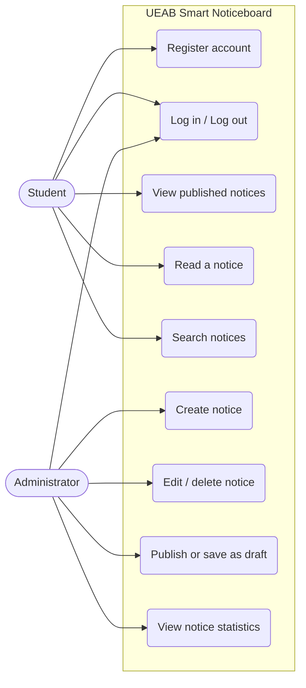

# Use Case Diagram

## User stories
- As a student, I want to see all official notices in one place so that I do not miss important information.
- As a student, I want to search notices so that I can find a specific announcement quickly.
- As an administrator, I want to publish a notice once so that I do not repeat it across many channels.
- As an administrator, I want to save a draft so that I can finish a notice before students see it.
